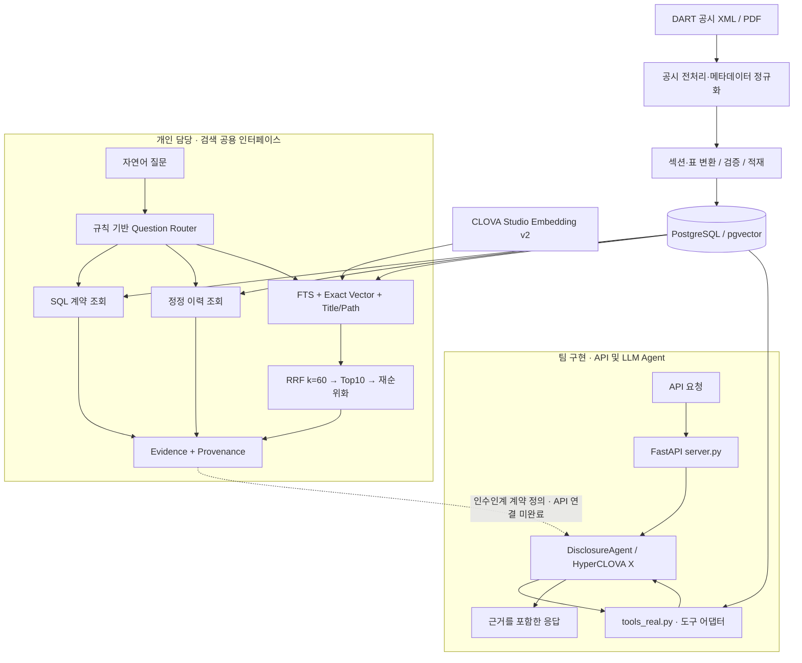

# Disclosure Analyst | 근거 기반 공시 분석 Agent

**공시에서 필요한 정보를 찾고, 수치와 정정 이력을 원문 근거와 함께 확인하는 AI 서비스**

기업 공시는 문서마다 구조와 표현이 다르고, 계약금액 같은 정형 정보와 사업·위험요인 같은 서술 정보가 섞여 있습니다. 정정 공시까지 고려하면 단순 키워드 검색만으로 질문에 맞는 근거를 찾기 어렵습니다.

Disclosure Analyst는 DART 공시를 PostgreSQL에 구조화하고, 질문에 따라 정형 조회·문서 검색·정정 이력 조회를 수행하는 팀 프로젝트입니다. HyperCLOVA X 기반 에이전트가 검색한 공시 근거를 활용해 답변하는 서비스를 목표로 개발했습니다.

제10회 미래에셋증권 AI Festival 공시 Agent 트랙 · **finance-agami 팀**
**개인 담당: jisuulee — PostgreSQL 데이터 처리, 검색 파이프라인, 질문 라우팅, 검색 평가**

## 주요 성과

| 항목 | 결과 | 평가 범위 |
|---|---|---|
| 제목·경로 검색 도입 | **R@10 46.02% → 53.10%, +7.08%p** | 동일 실험의 2채널 baseline 대비 3채널 검색, 섹션 평가 113문항 |
| 검색 순위 개선 | **MRR 0.2444 → 0.2587** | 위와 동일 조건. Top-1은 14.16%로 동일 |
| Retrieval V1 회귀 결과 | **R@10 77.78%, MRR 0.4212** | 독립 검토된 36문항 부분집합 |
| 데이터 처리 범위 | **정기공시 1,054건 · 섹션 82,862개 · 표 1,401,752개** | `periodic-full-v1` 적재 스냅샷 |
| 질문 라우팅 | **43/43 정책 회귀 문항의 route 일치** | 수작업 작성 내부 회귀셋 |

수치는 저장소의 기존 실험 결과이며 README 작성 과정에서 재실행한 결과는 아닙니다. 검색 지표는 답변 정확도가 아닙니다. [검색 비교](reports/title_path_retrieval_experiment.md) · [V1 결과](reports/retrieval_v1_freeze_summary.md) · [라우터 결과](reports/question_router_v1_summary.md)

## 기술 스택

| 영역 | 기술 | 적용 범위 |
|---|---|---|
| Language / Backend | Python, FastAPI, Uvicorn | 검색 모듈, 팀 API `/answer`·`/health` |
| Database | PostgreSQL 15, pgvector, pg_trgm, psycopg 3, psycopg2 | 정형 조회, FTS·trigram, 벡터 검색, 적재 |
| AI / LLM | HyperCLOVA X HCX-007·HCX-DASH-002 | 팀 에이전트의 구조화·도구 호출·답변 생성 |
| Embedding / Retrieval | CLOVA Studio Embedding v2(bge-m3, 1,024차원), Exact Cosine, RRF, 결정론적 reranker | 개인 담당 하이브리드 검색 |
| Data Processing | lxml, pypdf | 공시 XML/PDF 및 섹션·표 처리 |
| Infrastructure | Docker, Docker Compose, GitHub Actions, NCP 배포 workflow | 팀 개발·배포 구성 |
| Evaluation | Python 평가 스크립트, 단위·회귀 테스트, JSON/Markdown 리포트 | 검색 품질·지연시간·실패 유형 분석 |

## 시스템 아키텍처



실선은 구현된 호출·데이터 경로, 점선은 후속 통합 경계입니다. `src.retrieval.retrieve()`는 SQL·RAG·Correction 결과를 공통 evidence 형식으로 반환합니다. 현재 API의 `tools_real.py`는 별도 DB 어댑터를 사용하며 Retrieval V1 공용 인터페이스를 직접 호출하지 않습니다. [인수인계 계약](docs/retrieval_to_llm_handoff.md)

## 개인 기여

### PostgreSQL 데이터 처리와 근거 추적

- 회사·공시·원문 파일·계약·정정 관계를 분리한 스키마와 staging 검증·트랜잭션 기반 적재를 구현했습니다.
- 접수 이벤트와 원문 파일의 1:N 관계를 구분하고, 정규화 값과 원문·출처 정보를 함께 보존했습니다.
- 정기공시를 계층형 섹션과 표로 변환하고, 본문이 없는 상위 제목 및 표 전용 섹션을 구분해 문서 구조를 유지했습니다.
- 회사·기간·접수번호·금액 조건 등을 지원하는 SQL 검색과, 확정된 정정 관계만 사용하는 이력 조회를 구현했습니다.

[DB 적재](src/db/load_postgres.py) · [섹션 적재](src/db/load_document_sections.py) · [계약 조회](src/retrieval/contracts.py) · [정정 조회](src/retrieval/corrections.py)

### 하이브리드 검색과 RRF 기반 결과 통합

키워드 일치, 의미 유사도, 문서 제목의 계층 정보를 서로 보완하는 검색 신호로 사용했습니다.

```text
동일한 메타데이터 필터
  ├─ 본문 FTS                         Top20
  ├─ bge-m3 임베딩 / Exact Cosine     Top20
  └─ 제목·경로 FTS + trigram          Top20
                 ↓
       순위 기반 RRF 통합 (k=60)
                 ↓
       Top10 → 결정론적 특성 재순위화
                 ↓
       섹션 근거·출처·채널별 검색 정보
```

채널별 점수 척도가 달라 원점수 대신 `Σ 1 / (60 + rank)`의 RRF로 순위를 통합했습니다. 제목·경로 채널은 본문이나 질의 확장 없이 원래 질문과 heading 계층을 사용합니다. 최종 reranker는 추가 LLM 호출 없이 동작합니다.

[검색 기본값](src/retrieval/default_sections.py) · [Title/Path 및 RRF](src/retrieval/title_paths.py) · [재순위화](src/retrieval/reranker.py)

### 질문 라우팅과 LLM 인수인계 인터페이스

- 계약금액·상대방·기간 질문은 SQL, 사업·위험요인 설명은 RAG, 정정 이력은 Correction으로 분기하고, 복수 의도는 Composite로 처리했습니다.
- 회사명·연도·보고서 유형·접수번호를 추출하고, 정정 조회에 접수번호가 없는 경우 등은 추가 확인이 필요하다는 결정을 반환합니다.
- 결과를 `Evidence`와 `RoutedSearchResult`로 통일하고 날짜·Decimal의 JSON 직렬화, 출처·locator·route 정보를 포함하는 인수인계 계약을 정의했습니다.

[Question Router](src/retrieval/question_router.py) · [실행 어댑터와 Evidence](src/retrieval/routed_search.py) · [호출 예제](examples/retrieval_handoff_demo.py)

### 검색 평가와 실험 관리

- 정형 조회 42문항, 문서 검색 후보 120문항, 라우팅 정책 회귀 43문항을 목적별로 분리했습니다.
- Top-1, R@k, MRR 및 지연시간을 집계하고, 후보 누락과 최종 순위 문제를 구분해 실패를 분석했습니다.
- HNSW·후보 깊이 확대·부모 섹션 집계·질의 확장을 비교하고, 개선 근거가 충분한 설정만 V1 기본값으로 고정했습니다.
- 검토된 36문항과 독립 검토가 끝나지 않은 후보 문항을 구분해 보고했습니다.

[평가 정책](docs/retrieval_benchmark_policy.md) · [기본값 고정 정책](docs/retrieval_v1_freeze.md) · [평가 코드](eval/)

## 검색 성능과 평가 조건

### 동일 실험 내 baseline 비교

내부 후보 120문항 중 섹션 평가 대상 **113문항**에서 비교했습니다. 두 설정은 동일 질문·정답·필터·FTS/Vector 후보를 사용하고, RRF `k=60`, 최종 후보 10개 및 동일 결정론적 reranker를 적용합니다. 변경점은 **Title/Path Top20 채널 추가**입니다.

| 설정 | Top-1 | R@3 | R@5 | R@10 | MRR |
|---|---:|---:|---:|---:|---:|
| Baseline: FTS20 + Exact Vector20 | 14.16% | 32.74% | 37.17% | 46.02% | 0.2444 |
| + Title/Path20 | 14.16% | 34.51% | 38.05% | **53.10%** | **0.2587** |
| 변화 | 0.00%p | +1.77%p | +0.88%p | **+7.08%p** | **+0.0143** |

R@k는 정답 섹션 중 하나 이상이 상위 k개에 포함된 질문 비율이며, MRR은 첫 정답 순위의 역수 평균입니다. 개발 중 후보 평가셋을 사용한 비교로 독립 테스트 성능과 구분합니다.

[실험 보고서](reports/title_path_retrieval_experiment.md) · [실행 코드](eval/run_title_path_retrieval_experiment.py) · [평가 코드](eval/evaluate_title_path_retrieval.py)

### 최종 V1 및 보조 회귀 결과

| 평가 | 결과 | 해석 |
|---|---|---|
| Retrieval V1 / reviewed 36 | Top-1 25.00%, R@10 77.78%, MRR 0.4212 | 검토된 부분집합의 회귀 성능. 위 113문항과 직접 개선율 비교 불가 |
| 규칙 기반 Router / 자체 43문항 | Route 100%, clarification 100%, metadata 40개 assertion 100% | 정책 일관성 확인. 외부 질문 일반화 지표 아님 |
| 정형 SQL / 검수된 query parameter 42문항 | Top-1 100%, MRR 1.000 | 자연어 해석을 제외한 SQL/API 조회 검증 |
| V1 검색 지연시간 | 평균 179.03ms, P95 257.49ms | warm 로컬 DB·query embedding 캐시 재사용. LLM 답변 생성 제외 |

FTS 단독이 유리한 조건도 있었습니다. 이전 reviewed 36 실험에서 FTS Top-1은 50.00%로, 당시 2채널 RRF+reranker의 22.22%보다 높았습니다. 이 프로젝트는 근거 후보를 찾는 범위를 넓혔으며, 모든 질문에서 1위 정확도가 개선된 것은 아닙니다.

[V1 결과](reports/retrieval_v1_freeze_summary.md) · [라우터](reports/question_router_v1_summary.md) · [SQL](reports/retrieval_sql_baseline.md) · [기존 reranker 비교](reports/periodic_full_reranker_baseline.md)

## 기술적 문제 해결

### 제목·문서 계층을 검색 신호로 활용

| 단계 | 내용 |
|---|---|
| 문제 | FTS·Vector 2채널 baseline에서 섹션 R@10이 46.02%에 머물렀습니다. |
| 원인 | 실패 분석에서 기존 채널이 놓친 정답 중 일부를 제목·경로 검색으로 찾을 수 있었습니다. |
| 해결 | 제목·경로 FTS와 trigram을 별도 채널로 구성하고 동일 필터와 RRF로 결합했습니다. |
| 결과 | R@10 53.10%, MRR 0.2587을 기록했습니다. Top-1은 유지됐고, 기존 Top1/3/5/10 성공 문항이 해당 기준 밖으로 밀려난 사례는 없었습니다. |

### 반복 적재 시 FTS 인덱스 유실 방지

| 단계 | 내용 |
|---|---|
| 문제 | 정기공시 마이그레이션 재적용 시 검색 인덱스가 유지되지 않았습니다. |
| 원인 | generated `search_tsv` 컬럼 재생성으로 의존 인덱스가 삭제됐습니다. |
| 해결 | 키워드 마이그레이션 안에서 GIN 인덱스를 재생성하고 적재기에 전체 검색 인덱스 마이그레이션을 포함했습니다. |
| 결과 | 반복 적재 후 인덱스를 복원하는 경로와 이를 확인하는 회귀 테스트를 추가했습니다. |

[마이그레이션](src/db/migrations/003_keyword_search.sql) · [적재기](src/db/load_document_sections.py) · [회귀 테스트](tests/test_document_section_ingestion.py)

### 검색 실험의 채택 기준 정립

| 단계 | 내용 |
|---|---|
| 문제 | 후보 확대나 근사 벡터 검색의 효과를 최종 품질과 함께 판단해야 했습니다. |
| 원인 | 후보 회수율, 최종 순위, 메타데이터 필터, 실행 비용이 서로 다른 영향을 주었습니다. |
| 해결 | HNSW·Depth50/100·부모 집계·질의 확장을 분리 실험했습니다. |
| 결과 | 필터 조건의 품질·지연시간 절충과 최종 순위·비용을 고려해 Exact Cosine과 제한된 후보 깊이를 V1에 유지했습니다. 미채택 실험도 진단 자료로 보존했습니다. |

[Retrieval V1 freeze policy](docs/retrieval_v1_freeze.md)

## 프로젝트 구조

```text
├── agent.py / hcx_client.py      # 팀 LLM Agent 및 모델 클라이언트
├── server.py / tools_real.py     # 팀 API 및 DB 도구 어댑터
├── scripts/                     # 공시 전처리·검증
├── src/
│   ├── db/                      # 스키마·마이그레이션·적재
│   ├── rag/                     # 정기공시 섹션·표 변환
│   └── retrieval/               # SQL·FTS·Vector·RRF·라우터
├── eval/                        # 벤치마크·검색 실험·평가
├── tests/                       # 단위·회귀 테스트
├── reports/                     # 평가 결과 및 실패 분석
├── docs/                        # 설계·평가 정책·인수인계
├── examples/                    # 검색 인터페이스 사용 예시
└── retrospectives/              # 개발 회고
```

## 실행 및 재현

Python 3.12, Docker 및 승인된 데이터 스냅샷이 필요합니다. RAG와 실제 Agent 실행에는 CLOVA Studio API 키가 추가로 필요합니다.

```powershell
git clone https://github.com/jisuulee/mirae-asset.git
cd mirae-asset
python -m venv .venv
.\.venv\Scripts\Activate.ps1
python -m pip install -r requirements.txt -r requirements-rag.txt
python -m pip install 'psycopg[binary]>=3.2,<4'
Copy-Item .env.example .env
# POSTGRES_PASSWORD와 DATABASE_URL에 같은 로컬 비밀번호 설정
docker compose up -d postgres
```

DB·검색 적재는 [PostgreSQL 안내](docs/postgres_v1_local.md)와 [인수인계 가이드](docs/retrieval_to_llm_handoff.md)를 참고합니다. 검색 CLI는 `DATABASE_URL`, RAG 실행은 `CLOVASTUDIO_API_KEY`를 현재 프로세스 환경변수로 설정해야 합니다. `.env` 생성만으로 코퍼스가 적재되거나 모든 CLI에 환경변수가 전달되지는 않습니다. 현재 Compose는 pgvector 이미지를 사용하며 초기 적재 문서의 pgvector 미사용 설명은 초기 단계에 해당합니다.

데이터·스키마·환경변수를 준비한 뒤 팀 API를 실행합니다.

```powershell
# .env에 CLOVASTUDIO_API_KEY, POSTGRES_HOST 등 POSTGRES_*와 TOOLS_BACKEND=real 설정
python integration_check.py
uvicorn server:app --host 127.0.0.1 --port 8000
```

## 팀 역할

| 담당 | 구현 범위 |
|---|---|
| **본인 · jisuulee** | PostgreSQL 스키마·적재, 정기공시 검색 처리, SQL·하이브리드 검색, 질문 라우터, 검색 평가·실패 분석, LLM 인수인계 계약 |
| 팀원 · 공시 전처리 | 원천 공시 전처리·정규화·정정 관계 처리 파이프라인 |
| 팀원 · LLM Agent | HyperCLOVA X 연동, 에이전트 루프, 도구 호출, 답변 생성·검증 |
| 팀원 · API·인프라 | FastAPI 서버, Docker 및 NCP 배포 workflow |
